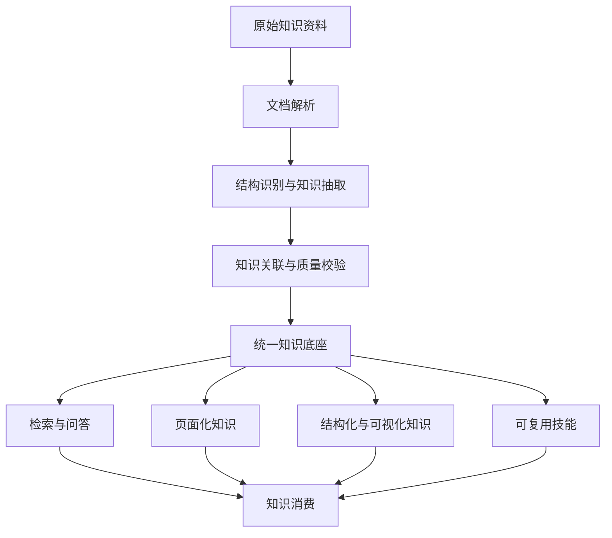
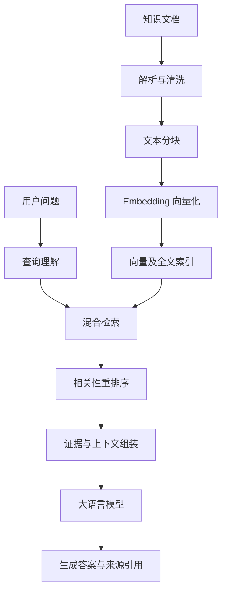
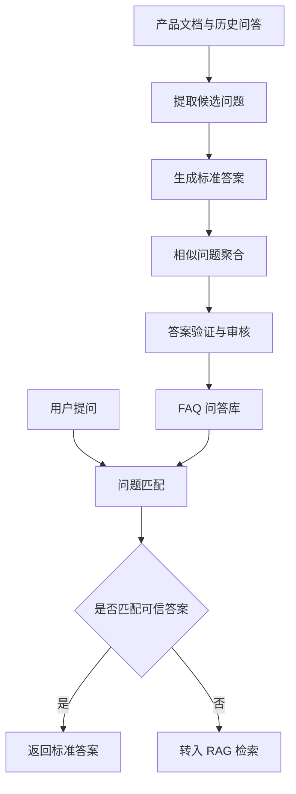
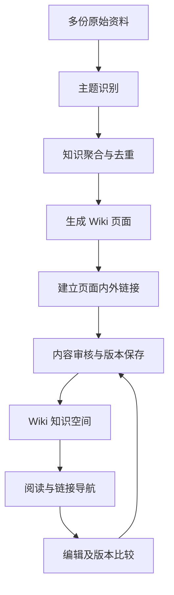
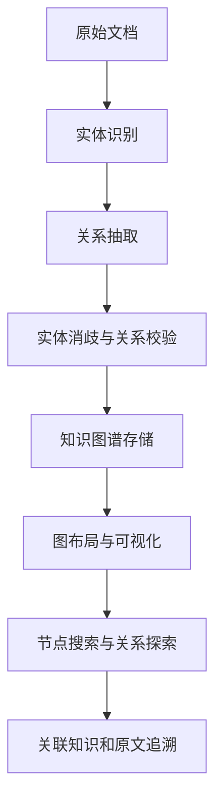
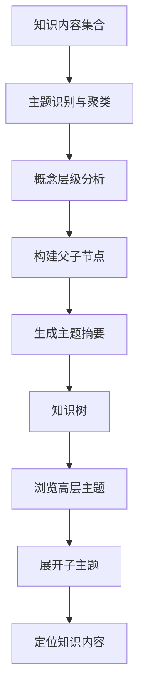
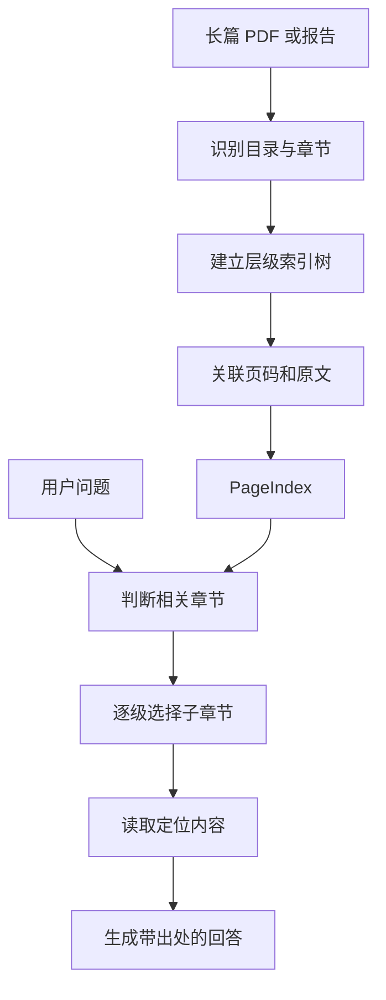
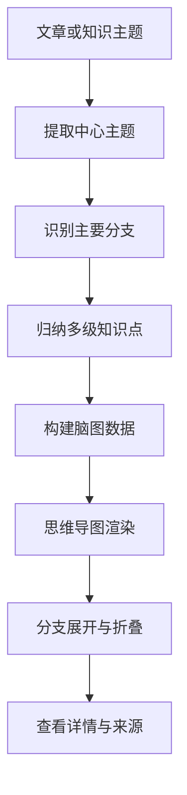
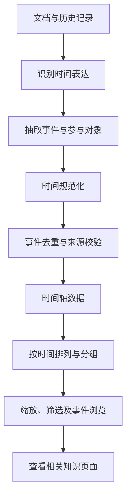
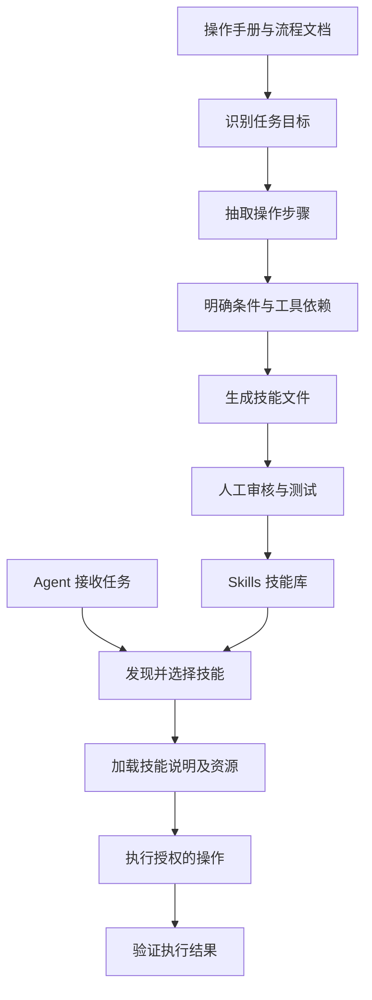

随着大语言模型和检索增强生成技术的发展，知识库逐渐成为企业知识管理、智能搜索与 AI Agent 应用的重要基础设施。许多知识库系统采用相似的技术路线：系统首先将 PDF、Word、Markdown、网页等资料解析为文本，再将文本划分为较小的片段，通过向量化和索引构建检索能力，最后利用大语言模型生成与用户问题相关的回答。

传统 RAG 通常能够找到其中的相关段落，却不一定能够将这些内容直接组织成可浏览的技术百科、可交互的知识图谱、按主题展开的知识树或者可以重复使用的操作技能。

本文围绕十种常见且易于理解的知识组织与呈现方式展开讨论：**RAG、FAQ、Wiki、Graph、Tree、PageIndex、MindMap、Timeline、Skills 和 PageCard。**其核心目标是让同一批资料能够根据内容特点和使用场景，形成多种具有不同组织结构的知识产物。

### 什么是知识库

知识库（Knowledge Base）是一个用于收集、组织、保存、维护和使用特定领域知识的系统。知识库不仅需要保存知识内容，还需要建立能够支持检索、解释、导航、更新和复用的组织机制。

从知识管理的角度来看，知识库与普通文件存储系统之间的区别，并不主要取决于底层是否使用数据库，而是取决于系统是否能够表达信息的含义、上下文和相互关系。

| 层次       | 核心内容                     | 典型示例                        |
| ---------- | ---------------------------- | ------------------------------- |
| 原始资料层 | 尚未经过统一组织的信息来源   | PDF、网页、Markdown、数据库记录 |
| 知识单元层 | 从资料中识别出的独立知识对象 | 段落、问题、事实、实体、事件    |
| 知识结构层 | 知识单元之间的组织与关联方式 | 层级、链接、关系、时间顺序      |
| 知识应用层 | 用户获取和使用知识的交互方式 | 搜索、问答、Wiki、脑图、技能    |

知识组织（Knowledge Organization）描述知识在系统内部如何分类、关联和存储，而知识呈现（Knowledge Presentation）描述用户通过何种界面和交互方式理解这些知识。

知识图谱是一种以实体和关系为中心的知识组织方式，而图谱可视化则是这一组织方式的图形化表现。思维导图通常以中心主题和分支结构呈现知识，但它的底层数据也可以来自知识树或者知识图谱。

知识编译可以理解为一条从原始内容到知识产物的加工流水线。系统首先识别文档结构，再提取实体、事实、主题、关系和事件等知识对象，随后建立对象之间的联系，并将其组织为适合不同使用场景的知识结构。



### RAG 基本原理

检索增强生成（Retrieval-Augmented Generation，RAG）是一种将外部信息检索与语言模型生成能力相结合的技术架构。传统语言模型主要依赖训练阶段获得的参数化知识，而 RAG 在生成回答之前引入外部资料检索，使模型能够根据当前检索到的信息回答问题。

典型的 RAG 系统包含文档处理、索引构建、查询理解、内容召回、结果重排序和答案生成等环节。文档处理阶段负责将不同格式的资料转换为可检索的内容单元；索引构建阶段负责组织关键词、向量以及必要的元数据；查询阶段则利用用户问题检索相关证据，并将经过筛选的内容提供给语言模型。



RAG 的主要限制在于，检索到语义相近的文本并不代表相关事实一定充分、正确或者适用于当前问题。系统仍然需要处理检索遗漏、来源冲突、上下文丢失以及模型生成内容缺乏证据等问题。

RAG 适用于企业内部知识问答、技术文档搜索、产品帮助中心、研发资料检索和跨文档信息查询等场景。对于文档数量较多、问题类型难以事先穷举的知识库，RAG 通常可以作为基础检索能力。

### FAQ标准问答对

FAQ（Frequently Asked Questions，常见问题）是一种以问题和答案为基本单位组织知识的方式。与 RAG 根据检索上下文动态组织回答不同，FAQ 通常提前建立相对稳定的问题与答案之间的映射关系，使系统能够为常见问题提供一致、可审核和可维护的回答。

一个 FAQ 知识对象通常包含标准问题、标准答案、相似问法、所属主题、适用条件以及知识来源等信息。例如，一份产品服务说明可能包含退款条件、处理时间和申请步骤。FAQ 编译过程可以将其中的规定转化为多个独立的问答条目，并为用户可能采用的不同表达建立统一的问题入口。



FAQ 的构建不应简单地将每个文档段落转换为一个问答对。系统需要判断候选问题是否具有明确含义、答案是否完整、相似问题是否存在实质差异，以及不同版本的文档是否改变了问题的适用条件。

FAQ 适合高频、稳定且有明确答案边界的问题。对于需要跨章节推理、临时组合多个事实或者探索开放性主题的问题，FAQ 通常需要与 RAG 配合使用。FAQ 常用于客户服务、产品说明、企业制度解释、IT 服务台和操作支持等场景。

### Wiki 知识页面链接

Wiki 是一种以页面为基本单元、通过链接建立知识关系的内容组织方式。Wiki 的主要价值不仅在于展示文档，还在于允许知识内容被持续编辑、扩展、修订和关联。传统文档通常具有相对固定的边界，一份文档主要围绕特定主题展开。Wiki 则允许系统将不同文档中的相关内容整合为新的知识页面，并通过内部链接连接概念、产品、技术模块以及操作说明。

例如，多个项目文档都可能介绍 PostgreSQL、Redis 和消息队列的使用方式。Wiki 可以将这些分散描述整理为独立的技术页面，再通过架构、部署和故障处理页面建立交叉引用。Wiki 因此更接近一种持续演化的知识出版体系，而不是一次性生成的文档摘要。



Wiki 页面通常应当包含标题、正文、所属分类、相关页面、来源引用和版本信息。Wiki 适用于企业知识百科、产品文档中心、技术架构知识库、团队协作手册和长期维护的领域知识体系。

### Graph 知识图谱

Knowledge Graph（知识图谱）是一种以节点和边表示知识对象及其关系的组织方式。知识图谱中的节点通常代表人物、组织、产品、系统、技术或其他实体，边则表示实体之间的依赖、包含、调用、参与和关联等关系。例如，一份技术架构文档可能包含“订单服务调用库存服务”“库存服务访问 Redis”“订单服务使用 PostgreSQL”等描述。知识图谱可以将这些自然语言表述转换为实体关系，再形成能够进行关系查询和图形探索的网络结构。



知识图谱构建过程中的主要难点不是绘制节点和连线，而是正确识别实体身份与关系含义。Graph 适用于系统依赖分析、组织关系探索、技术架构理解、知识关联检索以及跨文档实体发现。

### Tree 语义层级组织

Knowledge  Tree（知识树）是一种按照父子关系与语义层级组织知识的结构方式。知识树通常从范围较大的主题开始，逐级展开为子主题、概念和具体知识内容。与知识图谱能够表示多种关系不同，知识树突出知识的层级性，强调用户沿着某一条分类路径逐步理解主题。

例如，一个技术知识库可以组织为以下结构：

```
软件架构
├── 数据存储
│   ├── 关系型数据库
│   │   ├── PostgreSQL
│   │   └── MySQL
│   └── 缓存系统
│       └── Redis
└── 分布式系统
    ├── 消息队列
    └── 服务治理
```

知识树并不要求节点之间只能存在概念上的唯一关联。一个技术概念可能同时属于多个主题，但在严格的树结构中，通常需要为其选择主要父节点，其他关联可以通过引用链接保留。



知识树的构建需要关注主题粒度和分类一致性。层级过浅会使每个主题包含大量内容，而层级过深则容易增加导航成本。自动构建的知识树还需要处理主题重复、概念交叉和节点归属问题。系统可以利用语义聚类发现潜在主题，但最终生成的分类体系仍然需要进行命名规范化和结构检查。

### PageIndex 长文档的层级索引

PageIndex 是一种面向复杂长文档的层级检索方法，它强调利用文档本身的结构组织信息，而不是仅依赖固定长度文本片段进行相似度搜索。在长篇研究报告、法律文件、技术规范和年度报告中，章节标题、目录层级与页码通常承载了重要的上下文信息。PageIndex 的典型方法是先生成具有标题、层级和文本位置的文档树，再通过推理式搜索逐级选择相关章节。




PageIndex 适用于财务报告、法律合同、学术论文、技术标准、大型咨询报告等结构清晰且章节之间存在上下文依赖的资料。PageIndex 项目采用层级树索引和基于推理的检索机制，其原始方案强调不依赖向量数据库的文档检索。实际产品可以在这一方式之外增加向量检索或全文检索，但这些属于组合架构，而不是 PageIndex 方案本身的必要条件。

### MindMap 主题展思维导图

Knowledge MindMap（思维导图）是一种围绕中心主题向外扩展分支的知识可视化方式。思维导图通常将主要概念放置在视觉中心，再通过多级分支展示子主题、关键知识点与补充说明。它强调从整体到局部的理解过程，使用户能够在较短时间内观察某一主题的知识范围和内部组成。

与 Tree 相比，MindMap 的数据结构可以十分接近，但是两者的设计重点不同。Tree 更强调稳定的层级组织和目录导航，而 MindMap 更强调视觉理解、知识概览和围绕主题的联想。



系统在生成思维导图时，应当优先保证节点之间的主题归属清晰，而不是追求节点数量。过多的分支会使导图迅速失去视觉上的可读性。对于大型知识库，思维导图更适合围绕当前主题局部生成，而不是将全部知识实体一次性展示在同一张图中。MindMap 适用于学习笔记、会议总结、技术方案梳理、项目规划、培训资料和研究报告的结构概览。

### Timeline 时间组织知识

Timeline（时间轴）是一种根据时间顺序组织事件、状态变化和历史记录的知识呈现方式。普通知识文档主要按照主题和章节组织内容，但某些知识的核心意义取决于发生时间。例如，产品版本演进、公司重大事件、项目里程碑以及技术决策历史，都需要通过时间关系才能准确理解。

Timeline 将事件作为主要知识单元，每个事件通常包含事件名称、发生时间、参与对象、描述、相关文档和来源信息。时间轴既可以表示单一时间点上的事件，也可以表示具有开始和结束时间的持续性活动。



Timeline 的构建需要特别区分文档发布时间、事件发生时间和资料所描述的计划时间。Timeline 适用于产品发展历史、项目进度回顾、企业大事记、事故复盘、版本发布记录和历史研究。

### Skills 知识组织为可复用技能

Skills 是一种将知识、操作指导和配套资源组织成可复用技能包的方式。与 Wiki 主要用于阅读、FAQ 主要用于回答问题不同，Skills 更关注如何指导 AI Agent 完成一项具有明确目标的任务。

Skills 不是把所有文档内容简单复制到提示词中，而是应当围绕具体任务明确技能用途、适用条件、执行步骤、参考资料和必要的安全限制。



Agent Skills 开放格式采用包含 `SKILL.md` 的文件夹作为技能的基本组织单位，其中 `SKILL.md` 保存技能元数据和操作说明，其他目录可以存放参考文档、脚本和资源文件。

一个典型的技能目录如下：

```
skills/
└── document-review/
    ├── SKILL.md
    ├── references/
    │   └── review-rules.md
    ├── scripts/
    │   └── validate.py
    └── assets/
        └── review-template.md
```

Skills 的构建需要比普通知识摘要更加谨慎。文档中出现的操作指令不一定适合自动执行，知识编译器应当验证操作步骤、工具权限、失败处理方式和外部依赖，并通过必要的人工审核降低执行风险。Skills 适用于文档处理、代码检查、数据分析、自动化报告、运维协助和具有固定步骤的企业任务。

### PageCard 知识组织为卡片

PageCard 可以理解为一种以页面摘要卡片为基本单元的知识呈现方式。需要说明的是，PageCard 并不是与 RAG 或 PageIndex 对应的统一行业技术标准。本文使用这一名称，是为了描述一种常见的知识库产品设计：系统把较长的知识页面提炼为简洁的内容卡片，通过标题、摘要、标签、来源和页面链接，让用户快速判断知识内容的价值，并决定是否继续阅读。

PageCard 与单纯的知识点卡片存在一定差异。知识点卡片通常围绕单一概念或事实展开，而 PageCard 更适合作为完整知识页面的摘要和导航入口。

一个 PageCard 可以包含以下字段。

| 字段       | 说明               |
| ---------- | ------------------ |
| Title      | 知识页面标题       |
| Summary    | 页面内容摘要       |
| Tags       | 主题标签           |
| Category   | 所属知识分类       |
| Source     | 原始来源或关联文档 |
| Page Link  | 完整知识页面地址   |
| Updated At | 页面更新时间       |
| Cover      | 可选的封面或预览图 |

PageCard 的重点是降低知识发现成本，而不是代替完整知识内容。因此，系统应当保持卡片与原始页面之间的稳定关联，允许用户从卡片进入 Wiki、知识图谱或其他知识视图。PageCard 适用于知识库首页、知识专题导航、文档发现、精选知识展示和个人知识收藏等场景。

### 知识结构差异与应用边界

前面的讨论表明，十种知识方式并不具有完全相同的技术属性。部分方式是检索和生成机制，部分方式是知识数据结构，还有部分方式主要属于用户界面的呈现形式。

| 知识方式  | 主要组织单元       | 典型呈现形式       | 适合解决的问题             |
| --------- | ------------------ | ------------------ | -------------------------- |
| RAG       | 文本与检索证据     | 对话、搜索答案     | 从大量资料中找到并综合信息 |
| FAQ       | 问题与标准答案     | 问答列表           | 稳定回答高频问题           |
| Wiki      | 页面与内部链接     | 结构化知识页面     | 长期沉淀和维护领域知识     |
| Graph     | 实体与关系         | 关系网络           | 探索对象之间的关联         |
| Tree      | 主题与父子节点     | 层级知识目录       | 按主题逐级理解知识         |
| PageIndex | 文档章节与索引节点 | 章节导航及检索结果 | 定位复杂长文档中的信息     |
| MindMap   | 中心主题与分支     | 思维导图           | 快速理解知识整体结构       |
| Timeline  | 时间与事件         | 时间轴             | 了解事件发展与历史变化     |
| Skills    | 任务说明与操作资源 | 技能文件和调用结果 | 支持 Agent 复用操作知识    |
| PageCard  | 页面摘要与链接     | 卡片列表           | 快速发现和筛选知识内容     |


如果知识库为每一种呈现方式都建立独立的数据解析、内容抽取、来源管理和更新机制，系统就会出现大量重复处理过程。因此，多形态知识库需要建立共享的知识底座。统一知识模型可以包含原始文档、内容片段、知识主题、事实、实体、关系、事件以及页面等对象。

| 知识对象  | 主要作用                 | 可支持的知识形态    |
| --------- | ------------------------ | ------------------- |
| Document  | 保存资料来源与版本       | 全部形态            |
| Content   | 表示可定位的内容单元     | RAG、FAQ、PageIndex |
| Topic     | 表示知识主题及层级       | Tree、MindMap、Wiki |
| Entity    | 表示具有独立身份的对象   | Graph、Wiki         |
| Relation  | 表示实体或概念之间的关联 | Graph、Wiki、Tree   |
| Fact      | 表示可被证据支持的事实   | FAQ、Wiki、RAG      |
| Event     | 表示具有时间属性的事件   | Timeline            |
| Page      | 表示可编辑的知识页面     | Wiki、PageCard      |
| Procedure | 表示任务步骤与操作约束   | Skills              |

### 开源项目选型

| 建设领域     | 开源项目            | GitHub 地址                                                  | 主要参考价值               |
| ------------ | ------------------- | ------------------------------------------------------------ | -------------------------- |
| 文档解析     | Docling             | [docling-project/docling](https://github.com/docling-project/docling) | 多格式文档解析与结构化输出 |
| RAG          | RAGFlow             | [infiniflow/ragflow](https://github.com/infiniflow/ragflow)  | 知识检索与问答系统         |
| RAG / 索引   | LlamaIndex          | [run-llama/llama_index](https://github.com/run-llama/llama_index) | 多种索引与检索组件         |
| FAQ          | FastGPT             | [labring/FastGPT](https://github.com/labring/FastGPT)        | 问答数据组织与知识检索     |
| Wiki         | Wiki.js             | [requarks/wiki](https://github.com/requarks/wiki)            | 知识页面管理               |
| Wiki         | Outline             | [outline/outline](https://github.com/outline/outline)        | 协作知识空间               |
| Graph        | Microsoft GraphRAG  | [microsoft/graphrag](https://github.com/microsoft/graphrag)  | 实体关系抽取与图增强检索   |
| Graph        | Neo4j Graph Builder | [neo4j-labs/llm-graph-builder](https://github.com/neo4j-labs/llm-graph-builder) | 文档到知识图谱的构建       |
| Graph 可视化 | AntV G6             | [antvis/G6](https://github.com/antvis/G6)                    | 关系网络绘制与交互         |
| Tree         | RAPTOR              | [parthsarthi03/raptor](https://github.com/parthsarthi03/raptor) | 递归摘要与层次检索         |
| PageIndex    | PageIndex           | [VectifyAI/PageIndex](https://github.com/VectifyAI/PageIndex) | 长文档树索引与推理检索     |
| MindMap      | Markmap             | [markmap/markmap](https://github.com/markmap/markmap)        | Markdown 到思维导图        |
| Timeline     | vis-timeline        | [visjs/vis-timeline](https://github.com/visjs/vis-timeline)  | 可交互时间轴               |
| Timeline     | TimelineJS3         | [NUKnightLab/TimelineJS3](https://github.com/NUKnightLab/TimelineJS3) | 时间叙事与事件展示         |
| Skills       | Agent Skills        | [agentskills/agentskills](https://github.com/agentskills/agentskills) | 技能文件开放规范           |
| Skills       | Anthropic Skills    | [anthropics/skills](https://github.com/anthropics/skills)    | 技能组织与实现示例         |
| PageCard     | Astro Starlight     | [withastro/starlight](https://github.com/withastro/starlight) | 卡片式知识页面展示         |

不同用户对知识库的期望往往与其任务密切相关。研发人员可能希望检索技术细节，管理人员可能希望快速理解项目进展，领域专家可能需要维护知识定义，而 AI Agent 则可能需要调用可复用的操作流程。知识库可以根据用户意图和文档特征推荐知识呈现方式。

| 文档或任务类型 | 建议优先生成的知识形态   | 原因                         |
| -------------- | ------------------------ | ---------------------------- |
| 产品帮助文档   | FAQ、RAG、Wiki           | 同时满足标准答疑和内容检索   |
| 技术架构文档   | Graph、Wiki、MindMap     | 便于理解模块关系与整体结构   |
| 大型研究报告   | PageIndex、RAG、PageCard | 支持章节定位与内容概览       |
| 行业知识资料   | Tree、Wiki、MindMap      | 建立长期稳定的领域知识体系   |
| 项目过程记录   | Timeline、Wiki、PageCard | 组织事件、文档和历史变化     |
| 操作说明与 SOP | Skills、Wiki、FAQ        | 同时支持阅读、答疑与任务执行 |
| 多文档知识集合 | RAG、Tree、Graph、Wiki   | 支持跨文档发现与知识整合     |

